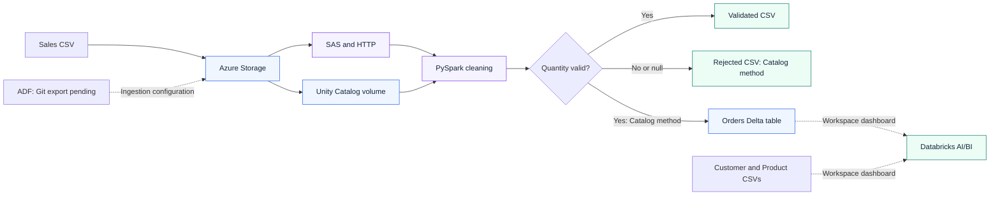

# Azure Databricks Retail Analytics

**From retail transactions to validated sales data and business insights.**


[](LICENSE)
[](https://github.com/avneetxsingh/azure-databricks-retail-analytics/actions/workflows/validate.yml)

A retail data engineering project exploring two ways to clean sales data in Azure Databricks: direct Azure Blob access through SAS credentials and governed access through Unity Catalog volumes. The workspace also includes a retail sales dashboard; its portable export will be added as the project is packaged.

[Get started](docs/setup.md) · [Architecture](docs/architecture.md) · [Data dictionary](docs/data-dictionary.md) · [Contribute](CONTRIBUTING.md)

## Business questions

- How much revenue do sales generate, and how does it change by day?
- Which products, categories, and brands contribute the most revenue?
- Which customers and states account for the largest sales contribution?
- Which sales satisfy the current quantity validation rule?

## Architecture



Solid lines describe the committed notebook workflows. Dashed lines show workspace components whose exports or integration checks are pending. This is not yet a one-command deployment.

## Included and pending

| Component | Repository status |
| --- | --- |
| SAS-based cleaning notebook | Included; credentials replaced with secret references |
| Unity Catalog cleaning notebook | Included; valid/rejected CSV outputs and validated Delta write |
| Setup, architecture, and data definitions | Included |
| Offline notebook and credential-pattern checks | Included |
| Sample CSVs | Not included; provenance and publication rights need confirmation |
| Azure Data Factory definitions | Pending Git connection/import |
| Dashboard JSON and screenshots | Pending export from the finished dashboard |
| Azure infrastructure templates | Pending export and review |

## Two access methods

| | SAS / HTTP example | Unity Catalog example |
| --- | --- | --- |
| Authentication | SAS tokens in a Databricks secret scope | Configured volume and storage permissions |
| Input | Blob download, local pandas read, then Spark | Spark CSV read from `/Volumes/...` |
| Output | One validated CSV through Blob REST API | Spark CSV directories and managed `orders` Delta table |
| Intended use | Small-file authentication/upload demonstration | Starting point for governed Spark processing |
| Constraint | Download and `toPandas()` collect data on the driver | Requires catalog, schema, volume, and table permissions |

These are **alternative workflows**, not sequential stages. See the [notebook guide](Notebooks/README.md) before running either one.

## Transformations

1. Load sales with headers and inferred source types.
2. Convert quantity to integer, unit price to double, and sale date using `M/d/yyyy`.
3. Remove duplicate `sale_id` values.
4. Calculate `total_amount = quantity × unit_price`.
5. Keep positive, non-null quantities; reject zero, negative, or null quantities.
6. Write outputs for the chosen access method.

Quantity validation is deliberately narrow. Malformed dates, conflicting duplicate IDs, missing dimension matches, and monetary precision need additional rules before production use. See [data definitions](docs/data-dictionary.md).

## Quick start

1. Clone this repository into a Databricks Git folder.
2. Prepare Azure Storage and the required Databricks permissions.
3. Supply your own authorized sales CSV with the documented columns.
4. Follow [setup.md](docs/setup.md) to configure the selected notebook.
5. Run that notebook from the top in a development environment.
6. Reconcile counts, output schema, and revenue before connecting a dashboard.

**Writes use overwrite mode.** Review output paths and table names first. The Catalog method replaces the project `orders` table and its schema when its final write runs.

## Reference sales snapshot

The inspected workspace dashboard displayed these unfiltered results for **September 1–10, 2026**:

| Metric | Reference value |
| --- | ---: |
| Revenue | $7,519.71 |
| Orders | 20 |
| Units sold | 29 |
| Average order value | $375.99 |
| Customers with purchases | 10 |
| Distinct products sold | 10 |

These document the observed workspace snapshot, not a runtime test of the revised notebooks. Recompute them after execution. The dashboard displays USD; the source schema has no currency field.

## Repository layout

```text
.
├── Notebooks/          # Reviewed notebooks and execution guide
├── adf/                # Connection/import instructions
├── dashboards/         # Dashboard export guide
├── data/               # Input and publication guidance
├── docs/               # Setup, architecture, definitions, status
├── infrastructure/     # Azure export guidance
├── tools/              # Offline repository checks
├── .github/            # Contribution templates
├── CONTRIBUTING.md
├── SECURITY.md
├── LICENSE
└── THIRD_PARTY_NOTICES.md
```

## Validation

Run from the repository root with Python 3.10 or later:

```bash
python tools/validate_repository.py
```

Checks cover notebook JSON, Python syntax, missing local Markdown links, committed outputs, and selected credential patterns. The same checks run in GitHub Actions on pushes to `main` and pull requests, without Azure credentials. They do not run Spark, verify cloud permissions, or prove the absence of every possible secret. Revised cloud execution remains pending.

## Next milestones

- Import ADF definitions into `/adf`.
- Export the completed dashboard and add screenshots.
- Confirm dataset rights and prepare shareable samples.
- Add reviewed infrastructure templates and configurable environment values.
- Run the revised notebooks and verify ingestion through dashboard results.

See [project status](docs/project-status.md) for the handoff checklist.

## Contributing and license

Read [CONTRIBUTING.md](CONTRIBUTING.md) and [SECURITY.md](SECURITY.md) before submitting changes. Project code and documentation use the [MIT License](LICENSE). External datasets, cloud services, dependencies, and trademarks retain their own terms; see [third-party notices](THIRD_PARTY_NOTICES.md).
