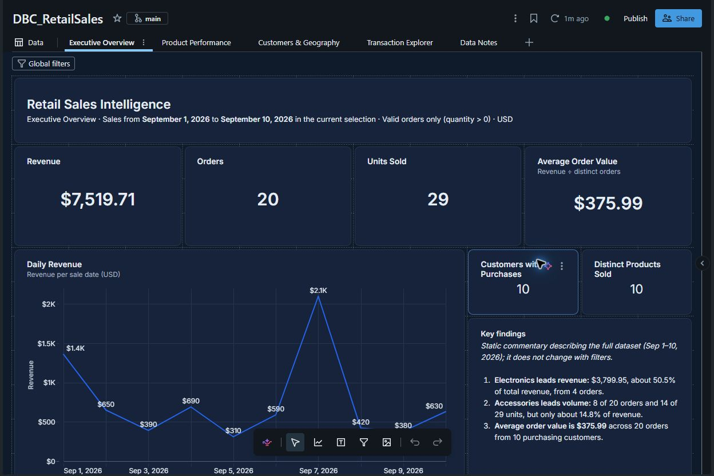
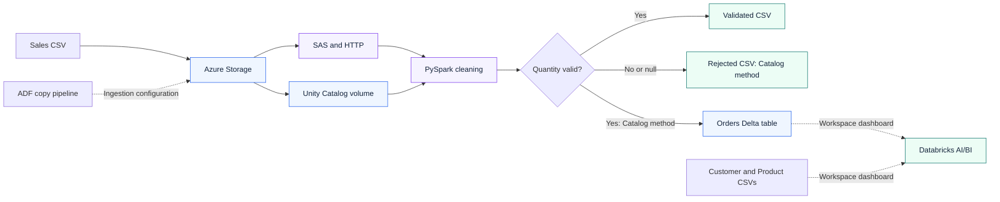

# Azure Databricks Retail Analytics

**From retail transactions to validated sales data and business insights.**


[](LICENSE)
[](https://github.com/avneetxsingh/azure-databricks-retail-analytics/actions/workflows/validate.yml)

A retail data engineering project exploring two ways to clean sales data in Azure Databricks: direct Azure Blob access through SAS credentials and governed access through Unity Catalog volumes. The repository includes the five-page retail sales dashboard, its SQL/metric definitions, and the original synthetic practice CSVs approved for publication by the owner.

[Get started](docs/setup.md) · [Architecture](docs/architecture.md) · [Data dictionary](docs/data-dictionary.md) · [Contribute](CONTRIBUTING.md)

## Why I built this project

I built this project to understand how Azure data engineering components work together: moving files with Azure Data Factory, accessing cloud storage, cleaning transactions with PySpark, storing validated data in Delta, and presenting results in a Databricks dashboard.

Retail sales gave me a concrete business problem to work with. Sales records explain what was purchased, while customer and product data add the context needed to compare revenue, product performance, and geographic contribution. I used a small synthetic dataset so I could trace individual records, reconcile every metric, and focus on understanding the workflow before increasing its scale.

**Databricks serverless compute was new to me when I started this project.** Working through storage access, notebook execution, Unity Catalog volumes, and the dashboard's SQL warehouse became a major part of the learning experience. Keeping both the SAS and Unity Catalog approaches in the repository shows that progression and the tradeoffs I encountered.

The goal was to produce a clear, reviewable portfolio project with real configuration files, readable code, documented decisions, and verified results. The repository also makes the remaining deployment and orchestration work explicit rather than presenting a learning project as a finished production platform.

## Dashboard preview



Explore the [five-page dashboard and import guide](dashboards/README.md).

## Business questions

- How much revenue do sales generate, and how does it change by day?
- Which products, categories, and brands contribute the most revenue?
- Which customers and states account for the largest sales contribution?
- Which sales satisfy the current quantity validation rule?

## Architecture



Solid lines describe the notebook workflows. Dashed lines show the workspace dashboard and the independently configured ADF ingestion stage; an orchestrated ingestion-to-dashboard run has not been verified. This is not yet a one-command deployment.

## Repository contents

| Component | Repository status |
| --- | --- |
| SAS-based cleaning notebook | Included; credentials replaced with secret references |
| Unity Catalog cleaning notebook | Included; valid/rejected CSV outputs and validated Delta write |
| Setup, architecture, and data definitions | Included |
| Offline notebook and credential-pattern checks | Included |
| Sample CSVs | Original owner-approved synthetic practice data included; see data/sample/NOTICE.md |
| Azure Data Factory definitions | Connected to GitHub; pipeline, dataset, linked service, factory definition, and ARM exports included |
| Dashboard JSON and screenshots | Five-page Git-tracked dashboard, extracted SQL/metrics, and page previews included |
| Azure infrastructure templates | Reviewed ARM export and example parameters included; deployment not tested |

## Two access methods

| | SAS / HTTP example | Unity Catalog example |
| --- | --- | --- |
| Authentication | SAS tokens in a Databricks secret scope | Configured volume and storage permissions |
| Input | Blob download, local pandas read, then Spark | Spark CSV read from `/Volumes/...` |
| Output | One validated CSV through Blob REST API | Spark CSV directories and managed `orders` Delta table |
| Intended use | Small-file authentication/upload demonstration | Starting point for governed Spark processing |
| Constraint | Download and `toPandas()` collect data on the driver | Requires catalog, schema, volume, and table permissions |

These are **alternative workflows**, not sequential stages. See the [notebook guide](Notebooks/README.md) before running either one.

## Transformations

1. Load sales with headers and inferred source types.
2. Convert quantity to integer, unit price to double, and sale date using `M/d/yyyy`.
3. Remove duplicate `sale_id` values.
4. Calculate `total_amount = quantity × unit_price`.
5. Keep positive, non-null quantities; reject zero, negative, or null quantities.
6. Write outputs for the chosen access method.

Quantity validation is deliberately narrow. Malformed dates, conflicting duplicate IDs, missing dimension matches, and monetary precision need additional rules before production use. See [data definitions](docs/data-dictionary.md).

## Challenges faced and how I addressed them

| Challenge | What happened | Resolution and learning |
| --- | --- | --- |
| Learning serverless data access | A driver-local CSV download and a Spark file read were not interchangeable in the serverless workflow. | Kept an explicitly small-file HTTP/pandas example and added governed Spark reads through Unity Catalog volumes. I learned to distinguish driver-local files from storage accessible to Spark. |
| Understanding Blob Storage and ADLS Gen2 | I initially associated the choice with structured versus semi-structured data. | Learned that both can hold the same file types, while hierarchical namespace adds directory capabilities. The exported storage configuration now has hierarchical namespace enabled. |
| Debugging missing files and SAS authentication | Incorrect container/file paths caused 404 errors; SAS permission and signature problems caused 403 errors. | Checked the exact destination, resource scope, permissions, and token formatting. Published notebooks now retrieve SAS values through secret references rather than embedding them in code. |
| Understanding Spark's execution model | An incorrect `price` reference appeared to work until a later action evaluated the transformation chain. | Corrected revenue to `quantity * unit_price` and reran the cleaning stages from the source. This made Spark's lazy evaluation and notebook state much clearer. |
| Separating CSV and Delta outputs | Early write cells mixed format and save-mode options, and the raw table was saved before cleaning. | Separated CSV directory writes from the managed Delta table write and moved the table write after validation. I also documented overwrite behavior. |
| Making the dashboard usable | Charts initially lacked an attached SQL warehouse; later review found unreadable KPI colors in dark mode and date assumptions tied to raw CSV text. | Attached the project warehouse, organized five focused pages, let KPI colors inherit the theme, and made date expressions accept raw text or cleaned Date columns. |
| Moving a cloud project into Git | Connecting a Git account did not automatically capture pipelines, data, dashboards, and Azure infrastructure together. | Tracked notebooks and the dashboard in a Databricks Git folder, connected ADF separately, exported ARM templates, and added the approved practice files and setup documentation. |

These were development and learning challenges encountered in this project, not production incidents. The [validation record](docs/validation.md) distinguishes checks that passed from writes and deployments that were not run.

## What I learned

- Storage paths, identity permissions, and token scope are part of the data workflow, not just initial setup details.
- Serverless compute still requires understanding where data lives and which engine can access it.
- A successful intermediate notebook cell does not prove that the complete Spark transformation chain is valid.
- CSV files, Spark CSV directories, and Delta tables are different outputs with different uses.
- A dashboard needs consistent metric definitions and working filters as well as a polished layout.
- A useful GitHub project includes reproducible instructions, configuration, sample data, and honest validation boundaries alongside the code.

## Quick start

1. Clone this repository into a Databricks Git folder.
2. Prepare Azure Storage and the required Databricks permissions.
3. Upload the bundled practice CSVs from `data/sample/` to the documented input locations.
4. Follow [setup.md](docs/setup.md) to configure the selected notebook.
5. Run that notebook from the top in a development environment.
6. Reconcile counts, output schema, and revenue before connecting a dashboard.

**Writes use overwrite mode.** Review output paths and table names first. The Catalog method replaces the project `orders` table and its schema when its final write runs.

## Reference sales snapshot

The inspected workspace dashboard displayed these unfiltered results for **September 1–10, 2026**:

| Metric | Reference value |
| --- | ---: |
| Revenue | $7,519.71 |
| Orders | 20 |
| Units sold | 29 |
| Average order value | $375.99 |
| Customers with purchases | 10 |
| Distinct products sold | 10 |

These reconcile to the bundled practice CSVs and the live dashboard. The Catalog cleaning stages separately returned 20 valid records; output-write cells were not executed in this review. The dashboard displays USD; the source schema has no currency field.

## Repository layout

```text
.
├── Notebooks/          # Reviewed notebooks and execution guide
├── adf/                # Connection/import instructions
├── dashboards/         # Dashboard export guide
├── data/               # Input and publication guidance
├── databricks/         # Optional development namespace setup SQL
├── docs/               # Setup, architecture, definitions, status
├── infrastructure/     # Azure export guidance
├── tools/              # Offline repository checks
├── .github/            # Contribution templates
├── CONTRIBUTING.md
├── SECURITY.md
├── LICENSE
└── THIRD_PARTY_NOTICES.md
```

## Validation

Run from the repository root with Python 3.10 or later:

```bash
python tools/validate_repository.py
python tools/validate_sample_data.py
```

Checks cover notebook JSON, Python syntax, missing local Markdown links, committed outputs, and selected credential patterns. The same checks run in GitHub Actions on pushes to `main` and pull requests, without Azure credentials. They do not run Spark, verify cloud permissions, or prove the absence of every possible secret. Catalog read/cleaning cells 1–9 passed in Databricks, the dashboard passed baseline/filter checks, and ADF definition validation passed. Output writes and fresh-environment deployment were not run. See [validation results](docs/validation.md).

## Next milestones

- Validate ADF Copy activity and its connection in the target environment.
- Validate deployment in a second environment before claiming full reproducibility.
- Add upstream dataset attribution if its original source becomes available.
- Test and refine infrastructure templates in an isolated environment.
- Test deliberate output writes and full orchestration in an isolated environment.

See [project status](docs/project-status.md) for the handoff checklist.

## Contributing and license

Read [CONTRIBUTING.md](CONTRIBUTING.md) and [SECURITY.md](SECURITY.md) before submitting changes. Project code and documentation use the [MIT License](LICENSE). External datasets, cloud services, dependencies, and trademarks retain their own terms; see [third-party notices](THIRD_PARTY_NOTICES.md).
