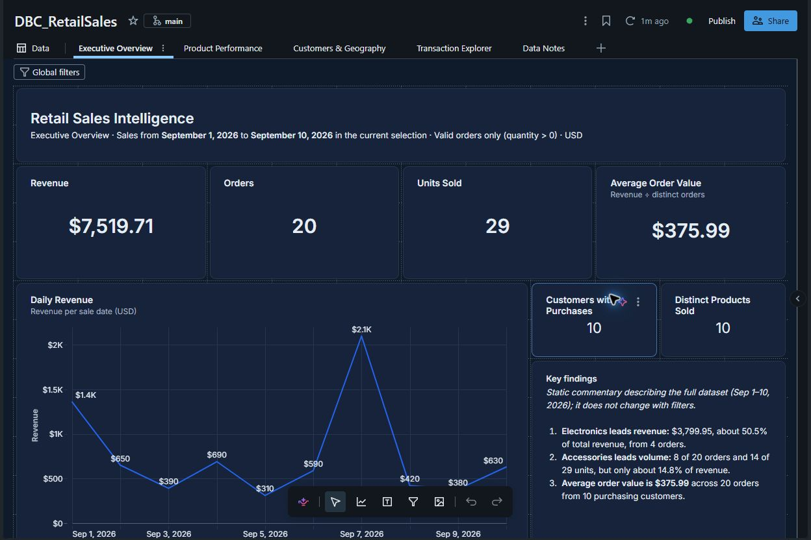

# Retail Sales Intelligence

[DBC_RetailSales.lvdash.json](DBC_RetailSales.lvdash.json) is the Git-tracked, importable dashboard. It contains five visible pages plus a shared filter page:

1. Executive Overview: revenue, orders, units, AOV, daily revenue, category/product contribution.
2. Product Performance: product and brand revenue, category metrics, product summary.
3. Customers & Geography: purchasing-customer metrics, customer contribution, state map/ranking.
4. Transaction Explorer: filtered totals and detailed sale records.
5. Data Notes: source, metric, rule, and data-quality context.

## Previews

| Page | Preview |
| --- | --- |
| Products | [Product Performance](screenshots/02-product-performance.jpg) |
| Customers | [Customers & Geography](screenshots/03-customers-geography.jpg) |
| Transactions | [Transaction Explorer](screenshots/04-transaction-explorer.jpg) |
| Notes | [Data Notes](screenshots/05-data-notes.jpg) |

Previews show the top of each page at the browser's normal viewport; the dashboard is interactive and some pages continue below the captured section.

## Recreate in another workspace

1. Set up the catalog/schema/volume in [setup.md](../docs/setup.md).
2. Upload all three bundled CSVs to the volume root and run the chosen cleaning workflow.
3. Ensure `ct_salesanalytics.schema_salesanalytics.orders` exists. Adjust dataset SQL paths if you use other names.
4. Import the `.lvdash.json` from the Dashboards page, or open it in a Git folder with dashboard support enabled.
5. Select an authorized SQL warehouse and refresh.
6. Reconcile totals, check filter behavior, and publish only after review.

Publishing, warehouse selection, schedules, and grants are separate from Git history. They are not all captured by a dashboard source export.

## SQL and metrics

The [sql/](sql/) folder contains the three extracted dataset queries and the metric configurations for sales metrics and data-quality checks. The metric source SQL is not a standalone replacement for the metric configuration; retain both measures/dimensions and dashboard source when importing.

The reviewed source accepts both raw `M/d/yyyy` dates and cleaned Date columns, preserves unmatched dimensions with labels, and deduplicates dimension IDs before joining. KPI foreground colors inherit the light/dark theme. These compatibility fixes are included in the Git source and synchronized to the workspace draft.

The data-quality query describes the **current orders table**. Once invalid rows have been removed upstream, it cannot reconstruct historical rejected-record counts. Use rejection outputs for those counts.

For this supplied dataset, revenue reconciles to $7,519.71 from 20 orders and 29 units. Metric definitions and limitations are in the [data dictionary](../docs/data-dictionary.md).

[Microsoft: dashboard source control](https://learn.microsoft.com/en-us/azure/databricks/dashboards/automate/git-support)
